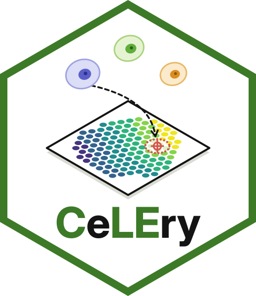
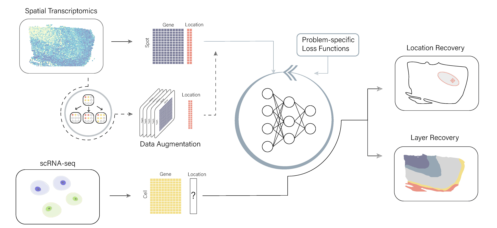

<h1 align="center"></h1>

**CeLEry** (Cell Location recovEry) is a supervised deep learning method that recovers the spatial origin of cells in single-cell RNA-seq (scRNA-seq) data by learning how gene expression relates to location in spatial transcriptomics data. It predicts the 2D coordinates, the tissue layer or the spatial domain of each cell together with an estimate of uncertainty, and it can enlarge a small spatial reference with replicates generated by a variational autoencoder.

A deep neural network learns, from the spots of a spatial transcriptomics section, how expression relates to location, and then places the cells of an scRNA-seq dataset on that section. With CeLEry you can:

- predict the 2D coordinates of each cell on the section;
- give each predicted location a confidence score, 1 minus the size of a region that contains the true location with a chosen probability;
- assign each cell to a tissue layer or a spatial domain, with the probability of each;
- enlarge a small spatial reference with replicates generated by a variational autoencoder;
- assign single-nucleus data to the eight spatial domains of a mouse brain section with a pretrained model.

## At a glance

The steps of the Methods of the paper map to the following functions.

| Manuscript step (Methods) | Functions |
|---|---|
| Data preprocessing: gene filtering and log transformation of the counts, genes shared by the two datasets | [make_annData_spatial](reference.md#make_anndata_spatial), [make_annData_query](reference.md#make_anndata_query), [get_common_genes](reference.md#get_common_genes) |
| Data preprocessing: standardization of each gene across the spots or cells of each dataset | [get_zscore](reference.md#get_zscore), [drop_NaN](reference.md#drop_nan) |
| Data augmentation for the training ST data: replicates generated by a variational autoencoder | [DataAugmentation](reference.md#dataaugmentation), [AugFit_domain](reference.md#augfit_domain) |
| Location prediction model: 2D coordinates (Eq. 3) | [Fit_cord](reference.md#fit_cord), [Predict_cord](reference.md#predict_cord) |
| Location prediction model: uncertainty region of the predicted location (Eq. 4) | [Fit_region](reference.md#fit_region), [Predict_region](reference.md#predict_region) |
| Location prediction model: spatial domains, with a logistic regression loss (Eq. 5) | [Fit_domain](reference.md#fit_domain), [Predict_domain](reference.md#predict_domain) |
| Location prediction model: tissue layers, with a rank-consistent logistic regression loss (Eq. 6) | [Fit_layer](reference.md#fit_layer), [Predict_layer](reference.md#predict_layer) |
| Evaluation of the predictions against known locations or layers (Results) | [get_Layer_LIBD](reference.md#get_layer_libd), [plot_confusion_matrix](reference.md#plot_confusion_matrix), [RelocationPlot](reference.md#relocationplot) |

## Next steps

- [Install CeLEry](install.md)
- [Run the quick start](get-started.md), which places 300 cells on a mouse brain section in about a minute
- Follow a tutorial: [cell coordinates](tutorials/coordinates.md), [tissue layers](tutorials/layers.md), [spatial domains](tutorials/domains.md), [data augmentation](tutorials/augmentation.md) or the [pretrained brain model](tutorials/pretrained.md)
- [Read the output](reading-output.md)
- [Reproduce the paper](case-studies.md)
- [Cite the paper](citation.md)
