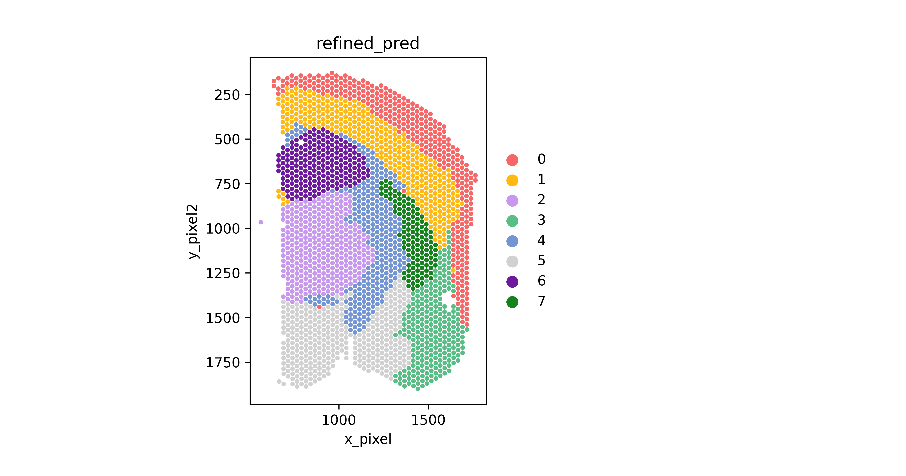
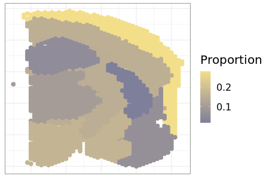

# Pretrained brain model

This tutorial applies a CeLEry model, pretrained on a Visium section of the mouse brain, to assign each cell of a mouse brain snRNA-seq sample to one of eight spatial domains.

Run the Python code in an interactive session, such as Jupyter, started at the root of a clone of the repository, with CeLEry installed as described in [Installation](../install.md). To run it as a script on Windows or macOS, follow [Running CeLEry in a script](../reading-output.md#running-celery-in-a-script).

## Model

The folder `pretrainmodel/Biogen/` of the repository holds three files:

- `Pretrained_model_075B.obj`: the trained network, saved with pickle.
- `Reference_genes_8_075B.obj`: the list of the 886 genes that the network takes as input, in the order it expects.
- `Pretrained_model_075B_probmat.csv`: a probability matrix from an earlier prediction, which the code below overwrites.

The network was trained on the Visium section 075B of a mouse brain dataset from Biogen (Li and Zhang, 2022). SpaGCN segmented the spots of this section into eight domains, numbered 0 to 7. The network is a domain classifier of the kind that [Fit_domain](../reference.md#fit_domain) trains, so it treats the domains as unordered.



The figure shows the spots of section 075B, colored by domain.

## Data

The query is sample 7G-1, from the gray matter, of the snRNA-seq data in the same dataset. Zenodo distributes the dataset as one archive, `CelEry_data.tar.gz` (518 MB), in the record cited below. Place the Cell Ranger file `filtered_feature_bc_matrix.h5` of sample 7G-1 at `data/Biogen/7G-1/filtered_feature_bc_matrix.h5`, relative to the root of the repository.

Li, K. and Zhang, B. *Mouse Brain snRNASeq and Visium Demo Dataset for CelEry*. Zenodo (2022). <https://doi.org/10.5281/zenodo.6640285>

## Prepare the query

```python
import pickle
from scanpy import read_10x_h5
import CeLEry as cel

import os
import pandas as pd
import torch
```

```python
QueryData_raw = read_10x_h5("data/Biogen/7G-1/filtered_feature_bc_matrix.h5")
QueryData = cel.make_annData_query (QueryData_raw)
```

[make_annData_query](../reference.md#make_anndata_query) changes `QueryData_raw` in place and returns it. It applies four steps:

1. It converts the gene names to upper case, as in the gene list of the model, and makes them unique.
2. It removes the genes detected in fewer than 3 cells.
3. It removes the genes whose names start with `ERCC` or `MT-`.
4. It scales the counts of each cell to the median total count and takes log(1 + x).

```python
## Load gene list
filename = "pretrainmodel/Biogen/Reference_genes_8_075B.obj"
filehandler = open(filename, 'rb') 
genenames = pickle.load(filehandler)

## Rearrange the data and filter the selected genes in the trained model.
Qdata = QueryData[:,list(genenames)].copy()
cel.get_zscore(Qdata)
```

`genenames` is the list of the 886 genes of the model. Indexing with this list puts the genes of the query in the order the model expects. The query must contain all 886 genes. A missing gene raises a `KeyError`. `.copy()` makes `Qdata` a separate object; without it, `Qdata` would be a view, and standardizing it would overwrite the expression in `QueryData` as well. [get_zscore](../reference.md#get_zscore) then standardizes each gene to mean 0 and standard deviation 1 across the cells of the query.

```python
Qdata[0].X
```

This line shows the standardized expression of the first cell, an array with 1 row and 886 columns.

## Predict the domains

[Predict_domain](../reference.md#predict_domain) applies the model to the query. Its arguments are:

- `data_test`: the query, with the genes of the model in the order of the model.
- `class_num`: the number of domains of the model, here 8.
- `path` and `filename`: the folder of the model file and its name without the extension `.obj`.
- `predtype`: the form of the result. `"probabilistic"`, the default, returns the matrix of probabilities. `"deterministic"` returns the predicted domains. Any other value returns both, as the list `[probabilities, domains]`.

`torch.manual_seed(0)` precedes each call because dropout stays active at prediction, so repeated calls differ unless the seed is set.

```python
model_location = "pretrainmodel/Biogen/Pretrained_model_075B.obj"

torch.manual_seed(0)
pred_cord = cel.Predict_domain(data_test = Qdata[0], class_num = 8, path = "pretrainmodel/Biogen", filename = "Pretrained_model_075B", predtype = "probability")
```

This call predicts the first cell only. `model_location` is not used further, because `Predict_domain` builds the same path from `path` and `filename`. The value `"probability"` is neither `"probabilistic"` nor `"deterministic"`, so `pred_cord` is a list of both results. `pred_cord[0]` holds the probabilities of the eight domains for the first cell. `pred_cord[1]` holds its predicted domain.

```python
torch.manual_seed(0)
pred_cord_all = cel.Predict_domain(data_test = Qdata, class_num = 8, path = "pretrainmodel/Biogen", filename = "Pretrained_model_075B", predtype = "deterministic")

prop_count = pd.DataFrame(pred_cord_all).value_counts().sort_index()
prop_weight = prop_count/sum(prop_count)
prop_weight
os.makedirs("output/Biogen", exist_ok=True)
prop_weight.to_csv("output/Biogen/prop_8_075B_7G-1.csv")
```

`pred_cord_all` holds the predicted domain of each cell, from 0 to 7. `prop_weight` gives, for each domain, the proportion of cells predicted in it. The last line saves the proportions to `output/Biogen/prop_8_075B_7G-1.csv`. Since pandas does not create folders, the line before it creates `output/Biogen`.

This call also adds the predicted domain to `Qdata.obs`, in the columns `pred_domain` (integer), `pred_domain_str` (string) and `domain_cel_pred` (floating point). Each of the two calls writes its probability matrix to `pretrainmodel/Biogen/Pretrained_model_075B_probmat.csv`, which replaces the file of that name in the repository. [Reading the output](../reading-output.md#layers-and-domains) explains how to read this file.

## Visualization in R

The R code below draws the proportions on the spots of section 075B with ggplot2. It runs in R, separately from the Python code above. It reads two tables:

- `obsdata_path`: the spot table of section 075B, saved from the `.obs` of its AnnData object. It holds the spot ID, the coordinates of each spot in `x_cord` and `y_cord`, and the domain of each spot in `refined_pred`. The repository does not include this table.
- `prediction_path`: the proportions written by the Python code above.

`objectname` names the output figure, which `png()` writes to the folder `outputdir`. This folder must exist before the code runs.

```r
library(ggplot2)
library(png)

outputdir <- "output/Biogen/plots/"
```

```r
obsdata_path = "output/Biogen/obsdata_8_075B.csv"
prediction_path = "output/Biogen/prop_8_075B_7G-1.csv"
objectname = "BiogenExample"

Density_plot <- function(obsdata_path, prediction_path, objectname){
  obsdata <- read.csv(obsdata_path, header = T)
  maxx <- max(obsdata$x_cord)
  obsdata$minus_xcord <- maxx - obsdata$x_cord
  pred_CeLEry <- read.csv(prediction_path, header = T)
  colnames(pred_CeLEry) = c("Domain", "Density")
  dataplot <- merge(obsdata, pred_CeLEry, by.x = "refined_pred", by.y = "Domain")
  png(file = paste0(outputdir,"Density_plot_",objectname,".png"), height = 300, width = 450)
  DensityPlot2D  <- ggplot(dataplot, aes(x = x_cord, y = y_cord) )  + 
    theme_bw()  + 
    geom_point(aes(color = Density), size = 3) + #shape = 21, color = "black",, stroke = 0.3
    # scale_y_reverse() +
    scale_color_gradient(low = "#7E7F9A", high = "#F3DE8A") +
    theme(text=element_text(size=20, family="URWHelvetica"), axis.text = element_blank(),
           axis.ticks=element_blank(),
           panel.spacing = unit(1, "lines")) +
    theme(strip.background =element_rect(fill="#3F4536",color="#3F4536"))+
    theme(strip.text = element_text(colour = 'white')) +
    theme(panel.border = element_rect(colour = "#3F4536"))  +
    labs(x = NULL, y = NULL, color = "Proportion")
  print(DensityPlot2D)
  dev.off()
}

Density_plot(obsdata_path, prediction_path, objectname)
```



Each spot of section 075B is colored by the proportion of the cells of sample 7G-1 predicted in its domain. The figure shows the result of the original tutorial.
